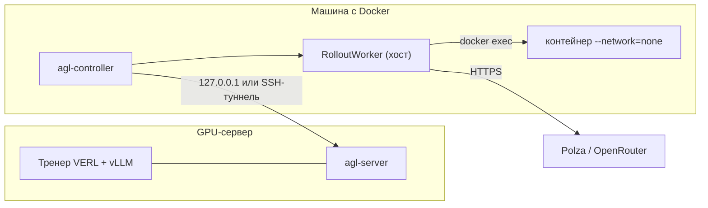

# Запуск ARBAS

Агент (оркестратор, субагенты, судья) всегда работает **на хосте**. Docker нужен только для
песочницы: на каждый роллаут поднимается контейнер из штатного образа SWE-smith с
`--network=none`, без bind-монтирований и без ключей. Внутрь заходят лишь команды `bash` и
`pytest` через `docker exec`. Поэтому подходит и обычный Docker, и rootless, а адреса вида
`host.docker.internal` / `10.0.2.2` не нужны. Kubernetes не используется.

Роллауты запускает `LocalReconciler`: по одному процессу `hierarchical.run:RolloutWorker` на роллаут.
Остаётся выбрать, где работает этот контроллер.



## Режим 1: всё на одной машине (Docker разрешён, в том числе rootless)

```bash
bash examples/swe_smith/run.sh train smoke-h200 [--config path.yaml] [--profile имя]
```

Команда подтягивает образы, поднимает шлюз, контроллер и тренер и по завершению останавливает
процессы и удаляет контейнеры, помеченные идентификатором запуска. Порт выбирается автоматически,
фиксируется через `AGL_SERVER_PORT`.

## Режим 2: GPU-сервер без Docker + отдельная машина с Docker

На GPU-сервере:

```bash
bash examples/swe_smith/run.sh train smoke-a100 --remote
```

На машине с Docker (Mac, VM или другой сервер):

```bash
bash examples/swe_smith/run.sh worker ipavlov
```

`--remote` публикует `outputs/swe-smith/active.json` и ждёт воркера. `worker` открывает
SSH-туннель `127.0.0.1:18080 -> 127.0.0.1:8080` на GPU-сервере (только loopback), читает оттуда
`active.json`, подтягивает нужные образы и запускает контроллер. При завершении убирает контейнеры и
закрывает туннель. Без `SSH_TARGET` воркер подключается к `127.0.0.1:8080` напрямую.
На обеих машинах должна быть одна версия кода.

## Каталоги запусков

Имя после `train` — подпись эксперимента (по умолчанию `experiment.name` из YAML).
Каталог запуска создаётся в формате `outputs/swe-smith/<name>-<MMDD-HH>/` по
московскому времени (при повторном запуске в тот же час добавляется суффикс
`-2`, `-3`). Внутри сохраняются снимок `training.yaml`, логи
`<run_id>-server.log`, `<run_id>-trainer.log`, `<run_id>-controller.log` (или `-worker.log`), TensorBoard и checkpoints. Результаты роллаутов лежат в `rollouts/<attempt>/`, состояние ORACLE — в `oracle/linucb.pkl`.
Симлинк `outputs/swe-smith/latest` указывает на последний запуск.

Временные файлы тренера и сокетов Ray лежат в отдельной папке запуска.
Лаунчер очищает её при штатном завершении или остановке через SIGINT/SIGTERM.
В Slurm по умолчанию данные пишутся в `SLURM_JOB_SCRATCH`, а лаунчер передаёт
Ray короткий путь к нему. Каталог можно переопределить через `AGL_TMPDIR`.

## Настройка окружения (`.env`)

Подготовьте GPU-окружение командой `bash examples/swe_smith/setup_training.sh`.
Скрипт создаёт `.venv` на Python 3.12 от `uv` и до установки пакетов проверяет
наличие `Python.h`, который нужен Triton для компиляции. На Slurm `.venv` может
быть симлинком на ваш каталог окружения.

Прямые зависимости обучения перечислены в `requirements.in`. Установщик
берёт версии всего дерева зависимостей из `requirements.txt`. После изменения
прямых зависимостей пересоберите этот файл на Linux x86_64 командой
`bash examples/swe_smith/setup_training.sh --lock`.

На отдельной машине с Docker (без GPU/VERL) создайте окружение воркера одной командой:
`uv venv --python 3.12 .venv && uv pip install -e ".[worker]"`. Скрипт `run.sh` всегда использует
`.venv` в корне репозитория (если он есть, даже поверх чужого `VIRTUAL_ENV`) и сохраняет
`CUDA_VISIBLE_DEVICES`, выданный `gpu-run` или Slurm.

На GPU-сервере создайте `~/.config/arbas/machine.env`:

```env
AGL_KEY=общий-ключ-связи
```

Для `worker` создайте `~/.config/arbas/ipavlov.env` (или `h200.env` / `machine.env`):

```env
SSH_TARGET=ipavlov-a100
REMOTE_REPO_DIR=/data/home/valeriy_gaideek/arbas
AGL_KEY=общий-ключ-связи
POLZA_API_KEY=ключ-polza
```

Указывайте ключ провайдера из `agents.subagent.base_url`. Для OpenRouter используйте
`OPENROUTER_API_KEY` вместо `POLZA_API_KEY`. Ключи остаются в памяти процесса на хосте и
в контейнер не попадают.

Локальный порт туннеля (`18080`), порт шлюза на сервере (`8080`) и путь к `active.json`
(`$REMOTE_REPO_DIR/outputs/swe-smith/active.json`) вычисляются автоматически; переопределяются через
`AGL_SERVER_PORT`, `AGL_SSH_REMOTE_PORT`, `AGL_REMOTE_OUTPUT_DIR`. Ограничьте права:
`chmod 600 ~/.config/arbas/*.env`.

## Изоляция песочницы и лимиты ресурсов

- Контейнер: `--network=none`, без монтирований и секретов, жёсткий лимит CPU/RAM на задачу
  (`--cpus`, `--memory`, `--memory-swap`), мгновенное удаление через хостовый reaper-процесс при
  гибели или тайм-ауте воркера (плюс запасной `sleep <ttl>` и `remove_run_containers`).
- Бюджет ресурсов на Docker-машине задаётся в `agents.sandbox` (`max_workers`, `cpus`, `memory`,
  по умолчанию 8 воркеров × 1 CPU / 6g RAM). На конкретной машине число воркеров можно переопределить
  через `AGL_MAX_LOCAL_JOBS` в `.env` (например, уменьшить для ноутбука или для Slurm-узла, где
  часть памяти нужна тренеру VERL). Для работы `--cpus`/`--memory` под rootless Docker необходимо
  делегирование cgroup v2 (`cpu memory`); если демон его не поддерживает, лаунчер выведет предупреждение.
- Перед стартом агента `setup` берёт ветку задачи, сохраняет тесты `FAIL_TO_PASS` из `HEAD~1` в памяти
  хоста, удаляет `/testbed/.git` и создаёт отдельный репозиторий с одним коммитом только для диффа.
  Истории с фиксом внутри контейнера нет.
- Перед оценкой конфигурация тестов (`conftest.py`, `pytest.ini`, `tox.ini`, `setup.cfg`,
  `pyproject.toml`, `sitecustomize.py`, `*.pth`) возвращается к состоянию коммита задачи, а скрытые
  тесты кладутся обратно; `pytest` запускается с `-I -B`.

## Единый конфиг `training.yaml`

Все параметры эксперимента, VERL, Ray и агентов собраны в одном файле
`examples/swe_smith/training.yaml`. Для нового эксперимента скопируйте его рядом
и передайте через `--config`:

```bash
bash examples/swe_smith/run.sh train my-exp --config examples/swe_smith/my-exp.yaml
```

Секция `agents:` валидируется схемой `AgentSettings` (`hierarchical/config.py`)
прямо при старте до запуска Ray и передаётся воркеру одним JSON-параметром
`ARBAS_AGENT_CONFIG`:
- `orchestrator`, `subagent`, `judge` — модели, лимиты ходов/токенов, температура, `reasoning`;
- `sandbox` — лимиты ресурсов и параллелизма (`max_workers`, `cpus`, `memory`), тайм-ауты команд/оценки/API, ожидание шлюза, лимит вывода, `f2p_only`;
- `reward` — штрафы за число ходов и длину промпта на обучении;
- `oracle` — список моделей (`models: []` отключает роутинг), чекпоинт `linucb.pkl`, веса стоимости и тип обратной связи (`semantic` / `episode`).
